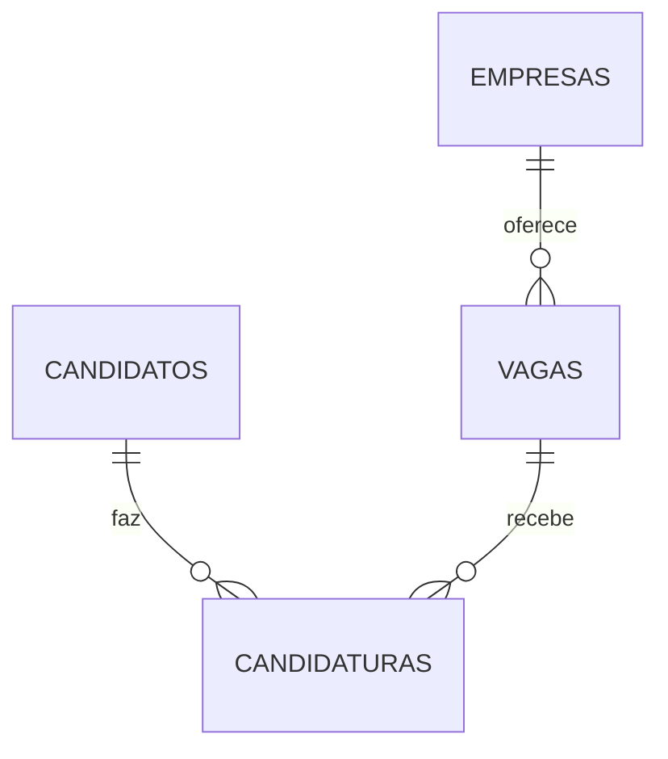

# Bancos de dados do 8Jobs (MongoDB)

Esta pasta cuida dos **bancos**: cria a estrutura e coloca dados de exemplo.

O projeto usa **4 bancos, um para cada microserviço**. Cada serviço só mexe no seu:

| Microserviço | Porta | Banco | Coleção |
|---|---|---|---|
| empresas | 3001 | `8jobs_empresas` | `empresas` |
| vagas | 3002 | `8jobs_vagas` | `vagas` |
| candidatos | 3003 | `8jobs_candidatos` | `candidatos` |
| candidaturas | 3004 | `8jobs_candidaturas` | `candidaturas` |

## Como usar (3 comandos)

Na raiz do projeto, com o MongoDB ligado (`sudo systemctl start mongod`):

```bash
npm run db:criar              # cria os 4 bancos, as coleções e os índices (pode repetir sem medo)
npm run db:popular            # coloca dados de exemplo (pode repetir, não duplica)
npm run db:popular -- --zerar # CUIDADO: apaga tudo dos 4 bancos e recoloca só os exemplos
```

O endereço do servidor vem da variável `MONGODB_URL` do arquivo `.env` da raiz
(se não existir, usa `mongodb://localhost:27017`). Os nomes dos 4 bancos ficam em
`database/conexao.js`. Para ver os dados, abra o MongoDB Compass, conecte em
`mongodb://localhost:27017` e abra os databases `8jobs_*`.

### Configurar cada microserviço

O arquivo `.env` de cada serviço (não vai para o Git) precisa apontar para o banco dele.
O `.env.example` de cada pasta já traz o valor certo; copie para `.env`:

```bash
cp services/empresas/.env.example services/empresas/.env      # 8jobs_empresas
cp services/vagas/.env.example services/vagas/.env            # 8jobs_vagas
cp services/candidatos/.env.example services/candidatos/.env  # 8jobs_candidatos
cp services/candidaturas/.env.example services/candidaturas/.env # 8jobs_candidaturas
```

## Explicação para quem está começando

Pense no MongoDB como um **armário de fichas**:

| No MongoDB | Na vida real | No 8Jobs |
|---|---|---|
| Database (banco) | o armário | `8jobs_empresas`, `8jobs_vagas`, `8jobs_candidatos`, `8jobs_candidaturas` |
| Coleção | uma gaveta | uma em cada banco: `empresas`, `vagas`, `candidatos`, `candidaturas` |
| Documento | uma ficha | uma empresa, uma vaga, uma pessoa, uma candidatura |
| Índice | índice de livro | deixa a busca rápida e, se for "único", barra repetidos |

## Os 4 bancos e como se ligam



Como cada banco é separado, um serviço **não consegue ler** o banco do outro. Uma ficha
"aponta" para outra guardando só o **ID** dela: a vaga guarda o `empresaId`, e a
candidatura guarda o `candidatoId` e o `vagaId`. Quem confere se esse ID existe são os
microserviços, perguntando uns aos outros pela API (pastas `clients/`), antes de gravar.

### empresas
| Campo | Tipo | Regra |
|---|---|---|
| nome | texto | obrigatório |
| cnpj | texto | obrigatório e **único** |
| email | texto | obrigatório, formato de e-mail |
| telefone | texto | opcional |
| cidade | texto | obrigatória |

### vagas
| Campo | Tipo | Regra |
|---|---|---|
| titulo, descricao, cidade | texto | obrigatórios |
| requisitos | texto | opcional |
| salario | número | obrigatório, não pode ser negativo |
| modalidade | texto | `Presencial`, `Híbrido` ou `Remoto` |
| empresaId | ID | obrigatório, aponta para uma **empresa** existente |
| status | texto | `ABERTA` (padrão) ou `FECHADA` |

### candidatos
| Campo | Tipo | Regra |
|---|---|---|
| nome, telefone, cidade | texto | obrigatórios |
| email | texto | obrigatório, formato de e-mail e **único** |
| habilidades | lista de textos | opcional (começa vazia) |

### candidaturas
| Campo | Tipo | Regra |
|---|---|---|
| candidatoId | ID | obrigatório, aponta para um **candidato** existente |
| vagaId | ID | obrigatório, aponta para uma **vaga ABERTA** existente |
| data | data | preenchida sozinha |
| status | texto | `ENVIADA` (padrão), `EM_ANALISE`, `APROVADA` ou `REJEITADA` |

A mesma pessoa **não** pode se candidatar duas vezes à mesma vaga (índice único em `candidatoId + vagaId`).

Todas as coleções também têm `createdAt` e `updatedAt` (data de criação e de alteração), preenchidos automaticamente.

## Quem faz o quê

- **Esta pasta (`database/`)**: cria os bancos, coleções e índices e coloca dados de exemplo.
- **Models de cada microserviço** (`services/*/src/models`): descrevem os campos e as regras (obrigatório, formato, valores permitidos) e validam **antes** de gravar.
- **Controllers + clients**: aplicam as regras de negócio (a empresa existe? a vaga está aberta?).

Os índices daqui são os mesmos que o Mongoose cria quando os serviços sobem, então não há conflito entre os dois.

## Problemas comuns

- **"Não foi possível conectar"**: o MongoDB está desligado. Rode `sudo systemctl start mongod`.
- **Banco antigo `8jobs`**: se você já tinha o banco único `8jobs`, ele continua lá sem uso. Pode apagar no Compass quando não precisar mais dos dados dele.
- **"não foi possível criar o índice único"**: já existem registros repetidos (mesmo e-mail ou CNPJ). Apague os repetidos no Compass e rode de novo.
- **Dados de exemplo "pulados"**: o CNPJ ou e-mail do exemplo já está em uso por outro registro seu. Nada foi sobrescrito.
